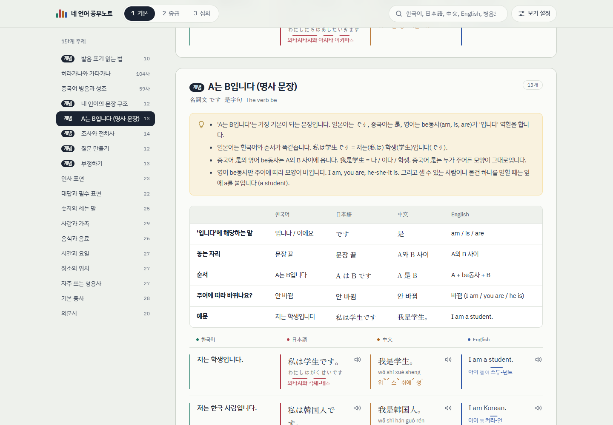
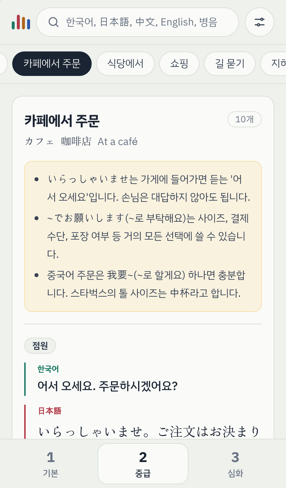
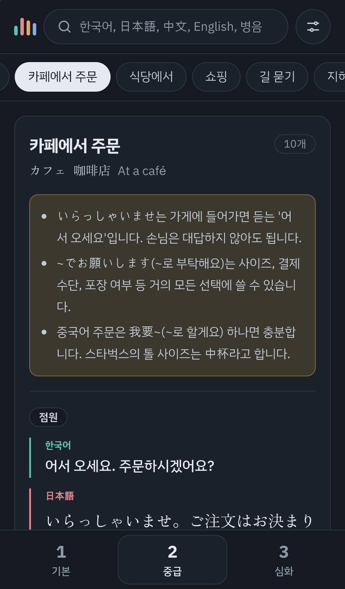
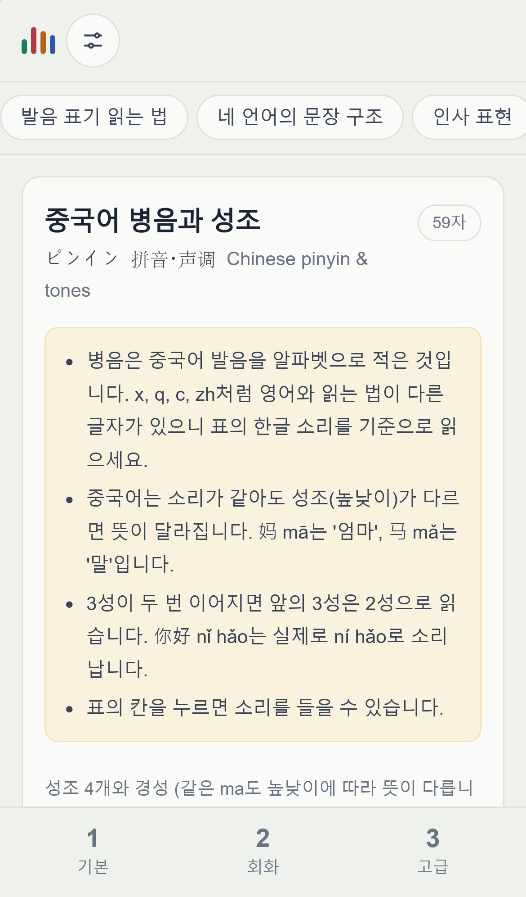

<div align="center">

# 🗣️ 네 언어 공부노트

**한 문장을 한국어 · 日本語 · 中文 · English로 나란히 익히는 공부노트 (웹앱 + 오프라인 HTML)**

외국어를 처음 배우는 사람도 읽을 수 있게, 모든 외국어 문장에 **한글 발음**과 **높낮이·속도 표기**를 붙였습니다.

### 🌐 [language-study-room.vercel.app](https://language-study-room.vercel.app/)




</div>

---

## 목차
- [소개](#-소개)
- [주요 기능](#-주요-기능)
- [미리보기](#-미리보기)
- [빠른 시작](#-빠른-시작)
- [한글 발음 표기 읽는 법](#-한글-발음-표기-읽는-법)
- [프로젝트 구조](#-프로젝트-구조)
- [콘텐츠 추가하기](#-콘텐츠-추가하기)
- [테스트](#-테스트)
- [버전 히스토리](#-버전-히스토리)
- [로드맵](#-로드맵)
- [관리 방식](#-관리-방식)

## 📖 소개
**한국어만 아는 사람**이 일본어, 중국어, 영어를 처음 시작할 때 쓰는 공부노트입니다.

- **한국어로 뜻을 잡습니다.** 같은 문장을 세 외국어로 바로 옆에서 비교합니다.
- **기본 → 중급 → 심화 3단계입니다.** 단계마다 **문법 개념을 먼저** 4개 언어로 비교하고, 그다음 단어와 회화로 넘어갑니다.
- **✈️ 여행 탭**에는 현지에서 바로 쓰는 장면별 표현과 **보여 주기 카드**가 있습니다. 말이 막히면 화면을 그대로 보여 주면 됩니다.
- **결과물은 두 가지입니다.** 콘텐츠는 같고, 쓰는 곳만 다릅니다.
  - **웹앱** (`web/`): React 기반입니다. Vercel에 배포하고, 홈 화면에 추가(PWA)하면 오프라인에서도 열립니다.
  - **단일 HTML** (`language-study.html`): 서버도 인터넷도 필요 없습니다. 아이폰 '파일' 앱 미리보기처럼 **JS가 꺼진 환경에서도** 모든 내용이 보입니다.

| 단계 | 개념 (먼저 익히기) | 단어·회화·상황 | 규모 |
|---|---|---|---|
| 1. 기본: 글자와 기초 단어 | 발음 표기, 문장 구조, A는 B입니다, 조사와 전치사, 질문, 부정 | 히라가나·가타카나, 병음, 인사, 숫자, 가족, 음식, 시간, 장소, 형용사, 동사, 의문사 | 주제 18개, 항목 328개 |
| 2. 중급: 활용과 일상 회화 | 시제, 형용사와 비교, 하고 싶다·할 수 있다, 양사, 부탁·권유·허락 | 자기소개, 카페, 식당, 쇼핑, 길 묻기, 교통, 호텔, 스몰토크, 약속, 핵심 문형 | 주제 15개, 항목 167개 |
| ✈️ 여행: 바로 쓰는 표현 (웹앱) | – | 보여 주기 카드, 공항, 숙소, 교통, 식당, 쇼핑, 긴급, 메뉴판, 음식 이름, 맛, 표지판 | 장면 11개, 표현 224개 |
| 🇺🇸 TOEIC: 시험 구성과 빈출 표현 (웹앱) | 시험 구성(공식), Part 5 문법 핵심 | 파트별 표현, 주제별 어휘 6개, Part 5 실전 문제 24개 | 섹션 13개, 표현·문제 약 300개 |
| 3. 심화: 공손한 표현과 상황별 표현 | 공손함의 단계, 일본어 경어, 조건과 가정, 수동과 사역, 이유와 반대, 돌려 말하기 | 미팅, 이메일, 전화, 개발자 협업, 공항, 병원, 클레임, 면접, 은행 | 주제 15개, 항목 185개 |

## ✨ 주요 기능
| 기능 | 설명 | 웹앱 | 단일 HTML (JS 없이) |
|---|---|:---:|:---:|
| 개념(문법) 섹션 | 단계마다 맨 앞에서 4개 언어 문법을 비교 표와 예문으로 설명 | ✅ | ✅ |
| 4개 언어 나란히 보기 | 한국어, 日本語(후리가나), 中文(병음), English | ✅ | ✅ |
| 한글 발음 + 높낮이·속도 | 일본어 악센트, 중국어 성조, 영어 강세, 연음, 약음, 쉼 | ✅ | ✅ |
| 공부할 언어 선택 | 日本語, 中文, English를 각각 켜고 끄기 (선택 기억) | ✅ | ✅ |
| 가리기 | 언어별로 흐리게 가리고, 누르면 그 칸만 보기 (암기 확인용) | ✅ | ✅ |
| 글자표 | 히라가나·가타카나 전환, 중국어 성조·성모·운모표 | ✅ | ✅ |
| 🇺🇸 TOEIC | 공식 시험 구성, 파트별·주제별 빈출 표현, Part 5 문제와 해설 | ✅ | ➖ |
| 📝 문제와 풀이 | 섹션마다 자동 생성 문제 (뜻, 외국어, 듣기, 빈칸 채우기), 오답 노트와 다시 풀기 | ✅ | ➖ |
| 🪧 보여 주기 카드 | 여행 탭: 고른 언어 문장을 전체 화면 큰 글씨로 보여 주기 | ✅ | ➖ |
| 🔊 발음 듣기 | Web Speech API (`ja-JP`, `zh-CN`, `en-US`) | ✅ | ❌ |
| 🔍 검색 | 4개 언어, 병음(성조 기호 없이 `xie xie`), 한글 발음(`오하요`) | ✅ | ❌ |
| 📑 주제별 페이지 | 단계 페이지(`/basic`)는 묶음별 주제 목록, 주제마다 한 페이지(`/basic/greet`)와 이전/다음 | ✅ | ➖ (한 페이지) |
| 진도와 이어 보기 | 끝까지 본 주제 완료 표시, 오답 수, 홈과 단계 페이지에서 마지막 주제 이어 보기 | ✅ | ➖ (`#stage-N`) |
| 📲 PWA | 홈 화면 추가, 오프라인 캐시 | ✅ | ➖ (파일 자체가 오프라인) |
| 라이트·다크 모드 | 시스템 설정을 따름 | ✅ | ✅ |

## 🖼️ 미리보기
<table>
<tr>
<td align="center"><br><sub>웹앱 · 모바일</sub></td>
<td align="center"><br><sub>웹앱 · 다크 모드</sub></td>
<td align="center"><br><sub>중국어 병음과 성조</sub></td>
</tr>
</table>

## 🚀 빠른 시작
**학습자 (사이트 이용):** 🌐 **[language-study-room.vercel.app](https://language-study-room.vercel.app/)**에 접속하면 바로 쓸 수 있습니다. 가입이나 설치는 필요 없습니다. 휴대폰에서 홈 화면에 추가하면 앱처럼 열리고, 인터넷 없이도 볼 수 있습니다.

> `language-study.html` 파일만 받아서 열어도 오프라인으로 똑같이 동작합니다.

**관리자 (수정과 빌드):**
```bash
npm install            # 루트에서 한 번 (npm workspaces: 루트 + web)
npm run web:dev        # 웹앱 개발 서버
npm run test:all       # 단일 HTML 테스트 + 웹앱 빌드·테스트
```

| 명령 | 하는 일 |
|---|---|
| `npm run web:dev` | 웹앱 개발 서버 (React Router dev) |
| `npm run web:build` | 웹앱 빌드: 홈·단계 5개·주제 72개 prerender + 서비스 워커 → `web/build/client` |
| `npm run web:test` | 웹앱 빌드 후 Playwright E2E |
| `npm run build` | 단일 HTML 빌드: `data/` → `language-study.html` |
| `npm test` | 단일 HTML: 데이터 검증 → 단위 테스트 → 빌드 → E2E |
| `npm run web:unit` | 웹앱 단위 테스트 (문제 생성) |
| `npm run test:all` | 위 모두 |
| `npm run validate` | 데이터 검증 (빈 칸, 기호 짝, 성조 숫자와 병음 음절 수) |

> Node.js 22.12 이상이 필요합니다 (Vite 8). 데스크톱 E2E는 PC에 설치된 Chrome(`channel: "chrome"`)을 씁니다.

### ▲ Vercel 배포
1. Vercel에서 이 저장소를 Import합니다.
2. **Root Directory**를 `web`으로 지정하고, **Include files outside the root directory**를 켭니다. 루트의 `data/`와 `lib/`를 쓰기 때문입니다.
3. 나머지 설정은 `web/vercel.json`에 있습니다.
   - 설치: 루트에서 `npm ci`
   - 빌드: `npm run build`
   - 출력: `build/client`
   - `cleanUrls`
   - 캐시 헤더

배포 결과는 모두 정적 파일입니다. 런타임 서버가 없으므로 Vercel 무료 플랜으로도 충분합니다.

## 🔤 한글 발음 표기 읽는 법
data에는 가벼운 기호로 적고, 빌드할 때 화면용 모양으로 바뀝니다. 자세한 규칙은 [`docs/pron-notation.md`](docs/pron-notation.md)에 있습니다.

| 화면 | data 표기 | 뜻 | 예 |
|---|---|---|---|
| <ins>**굵은 윗줄**</ins> | `[ ]` | 높게 / 세게 | `오[하요-]`, `굿 [모]닝` |
| `→ ↗ ↘↗ ↘ ·` | `1 2 3 4 0` | 중국어 성조 (1~4성, 경성) | `니2 하오3` → 니↗ 하오↘↗ |
| `-` | `-` | 길게 | `토-` |
| `‿` | `_` | 이어서 빠르게 | `[땡]_큐` → 땡‿큐 |
| 작고 흐리게 | `( )` | 약하고 빠르게 | `데(스)` |
| `│` | `\|` | 잠깐 쉼 | 긴 문장의 끊어 읽기 |

## 🗂️ 프로젝트 구조
```text
language-study/
├── web/                     # 🆕 웹앱 (Vercel Root Directory)
│   ├── app/
│   │   ├── routes/          # home.tsx, stage.tsx (/:stage 주제 목록), topic.tsx (/:stage/:topic)
│   │   ├── components/      # cells, sections, chrome (상단 바, 탭, 설정), topics (주제 목록, 이전/다음)
│   │   ├── state/           # 보기 설정 Context (localStorage)
│   │   ├── lib/             # 검색, 발음 듣기, 단계 슬러그, 주제 주소와 진도
│   │   └── app.css          # Tailwind v4 @theme 토큰 + 학습 카드 component class
│   ├── scripts/             # sw.mjs (서비스 워커), serve.mjs (테스트 서버)
│   ├── tests/e2e/           # Playwright (iPhone, iPhone JS 끔, Chrome)
│   ├── react-router.config.ts  # ssr:false + prerender (주소 목록은 data에서 생성)
│   └── vercel.json
├── language-study.html      # 단일 HTML 빌드 결과 (오프라인용)
├── build.mjs                # data → 정적 HTML (CSS와 JS를 inline으로 포함)
├── styles.css               # 디자인 토큰, 반응형, :has() 기반 토글
├── runtime.js               # JS가 있을 때만: 단계 전환, 검색, 발음 듣기, 설정 기억
├── lib/
│   ├── pron.mjs             # 한글 발음 표기 변환 (두 결과물이 함께 사용)
│   └── pron.d.mts           # 타입 정의
├── data/
│   ├── index.js             # STAGES export + 데이터 형식 설명
│   ├── index.d.ts           # 데이터 타입 (웹앱이 사용)
│   ├── stage1.js ~ stage3.js
│   ├── kana.js              # 히라가나표
│   └── pinyin.js            # 성조, 성모, 운모표
├── scripts/
│   └── validate-data.mjs    # 데이터 검증
├── tests/
│   ├── unit/                # node:test (발음 변환, 데이터 구조)
│   ├── js.spec.js           # JS 켠 환경 E2E
│   ├── nojs.spec.js         # JS 끈 환경 E2E (아이폰 파일 미리보기)
│   └── structure.spec.js    # 구조, 접근성, 공통 동작
└── docs/
    ├── ROADMAP.md           # 버전별 계획
    ├── pron-notation.md     # 발음 표기 규칙
    └── images/              # README 스크린샷
```

**설계 원칙**
- **콘텐츠 단일 원본**: `data/`와 `lib/pron.mjs` 하나를 웹앱과 단일 HTML이 함께 씁니다. 콘텐츠는 한 번만 고치면 됩니다.
- **Prerender 우선**: 웹앱의 모든 페이지는 빌드할 때 정적 HTML로 미리 만듭니다(React Router `ssr:false` + `prerender`). 그래서 첫 화면이 빠르고, 검색엔진과 JS 없는 환경에서도 내용이 보입니다.
- **안전한 발음 렌더링**: 발음 표기는 토큰 트리(`tokenizePron`)로 그립니다. `innerHTML`은 쓰지 않습니다.
- **페이지별 데이터**: 콘텐츠는 route `loader`(`content.server.ts`)에서만 읽어서, 각 페이지에는 그 단계 데이터만 들어갑니다. 클라이언트 JS 번들에는 콘텐츠가 없습니다.
- **가벼운 HTML**: 반복되는 학습 카드 요소는 Tailwind `@layer components`의 짧은 class로 묶었습니다. 단계 페이지 HTML이 888KB에서 369KB로 줄었습니다 (gzip 42KB).
- **단일 HTML은 런타임 의존성 0**: 프레임워크 없이 Node 내장 모듈만으로 빌드합니다. JS 없이도 되는 기능은 `checkbox`와 `:has()`로 만들었습니다.

## ✍️ 콘텐츠 추가하기
항목 형식은 [`data/index.js`](data/index.js) 맨 위 주석에 있습니다. list 항목은 이런 모양입니다.

```js
// [한국어, [일본어, 가나 읽기, 한글 발음], [중국어, 병음, 한글 발음], [영어, 한글 발음]]
["감사합니다",
  ["ありがとうございます", "", "아[리]가토- 고[자이마](스)"],
  ["谢谢", "xiè xie", "시에4 시에0"],
  ["Thank you.", "[땡]_큐."]]
```

1. 해당 단계 파일(`data/stageN.js`)에 항목을 추가합니다.
2. `npm run validate`로 빈 칸과 성조 숫자 개수를 확인합니다.
3. `npm run test:all`로 웹앱과 단일 HTML을 모두 확인합니다.

- 중국어는 **간체**로 쓰고, 병음은 **음절마다 띄어** 씁니다.
- 예문에 실제 개인 이름을 쓰지 않습니다. 이름이 필요하면 `홍길동(ホン・ギルドン / 洪吉童 / Gildong Hong)`처럼 가상 이름을 씁니다.

## 🧪 테스트
| 종류 | 도구 | 범위 |
|---|---|---|
| 데이터 검증 | `scripts/validate-data.mjs` | 모든 항목의 필수 칸, `[ ]`·`( )` 짝, 병음 음절 수와 성조 숫자 개수 일치 |
| 단위 테스트 (28개) | `node:test` | 발음 표기 → HTML 변환, XSS escape, 검색 키, 섹션 id 유일성, 간체 확인, 가상 이름 사용 |
| 단일 HTML E2E (3개 환경, 86회) | Playwright | 단계 전환과 기억, 검색, 가리기, 언어 선택, 발음 듣기, 병음표, 가로 스크롤 없음, 링크와 id 무결성, 접근성(aria-label, lang) |
| 웹앱 단위 테스트 (12개) | `node:test` (TS) | 문제 생성(모든 섹션 출제 가능, 보기 유효성, 빈칸 복원, 언어·TTS 조건, 오답 노트), 주제 주소 유일성, prerender 목록, 주제 묶음, 진도 저장값 |
| 웹앱 E2E (3개 환경, 85회) | Playwright | 위 시나리오에 더해 URL 직접 진입과 404, 주제 목록과 이전/다음, 완료와 이어 보기, 주제 페이지에서 단계 검색, 예전 `#섹션` 주소 이동, **모든 주제 페이지의 링크·id·발음 무결성**, prerender HTML(JS 끔), SEO 제목, PWA manifest와 서비스 워커, **오프라인에서 모든 단계와 주제 열기** |

| 대상 | 프로젝트 | 조건 |
|---|---|---|
| 단일 HTML | `iphone13-nojs` / `iphone13-js` / `desktop-chromium` | **offline + `file://`** (데이터 없는 휴대폰) |
| 웹앱 | `iphone13` / `iphone13-nojs` / `desktop-chrome` | Vercel과 같은 규칙의 정적 서버(`web/scripts/serve.mjs`) |

## 🏷️ 버전 히스토리
자세한 변경 내역은 [`CHANGELOG.md`](CHANGELOG.md)에 있습니다.

| 버전 | 날짜 | 요약 |
|---|---|---|
| **v2.4** | 2026-11-28 | 📑 주제별 페이지: 단계 페이지는 묶음별 주제 목록, 주제마다 한 페이지와 이전/다음, 완료 표시와 이어 보기 (iPhone 기준 한 페이지 약 200화면 → 주제당 2~17화면) |
| **v2.3.1** | 2026-11-26 | 🛠️ 작업 도구: 커밋 전 자동 검사 hook, `/release` skill (저장소에 포함, 다른 PC에서도 동일) |
| **v2.3** | 2026-11-26 | 🇺🇸 TOEIC 탭: 공식 자료로 확인한 시험 구성, 파트별 표현 100개, 주제별 어휘 164개, Part 5 문법 12개와 문제 24개(해설) |
| **v2.2** | 2026-11-26 | 📝 문제와 풀이: 데이터로 문제 자동 생성 (뜻, 외국어, 듣기, 빈칸 채우기), 오답 노트 |
| **v2.1** | 2026-11-26 | ✈️ 여행 탭 (장면 11개, 표현 224개), 보여 주기 카드(전체 화면 큰 글씨, 언어 기억, 들려주기), 탭 4개 |
| **v2.0.1** | 2026-11-26 | 성능: 콘텐츠를 route loader로 옮겨 JS 번들에서 데이터 제거 (202KB → 12KB), 단계 페이지는 그 단계 데이터만 포함 |
| **v2.0** | 2026-11-26 | ⚛️ 웹앱 전환 (React 19 · React Router 8 prerender · TS · Tailwind 4), 영문 URL, PWA 오프라인, Vercel 배포 설정. 단일 HTML은 유지하고 콘텐츠는 공유 |
| **v1.2** | 2026-11-26 | 기본/중급/심화로 재편, 단계마다 개념(문법) 섹션 13개 추가, 콘텐츠 약 350개 → 680개, 모바일 후리가나 줄바꿈 개선 |
| **v1.1.1** | 2026-11-26 | README 추가, 테스트 확대 (단위 테스트 도입, 구조·접근성 E2E), 발음 변환 모듈 분리, 병음 ü 검색 개선 |
| **v1.1** | 2026-11-26 | 🇨🇳 중국어 추가, 모든 외국어에 한글 발음과 높낮이·속도 표기, 공부할 언어 선택, 병음표, 버전 문서 체계 |
| **v1.0** | 2026-11-26 | 한·일·영 3개 언어, 3단계 구성, 가나표, 검색, 가리기, 발음 듣기, JS 없이 보기 |

## 🗺️ 로드맵
자세한 범위는 [`docs/ROADMAP.md`](docs/ROADMAP.md)에 있습니다.

- [x] **v1.0**: 한·일·영 3개 언어 공부노트
- [x] **v1.1**: 중국어, 한글 발음과 높낮이·속도 표기
- [x] **v1.2**: 기본 / 중급 / 심화 재편, 개념(문법) 섹션
- [x] **v2.0**: ⚛️ React 웹앱 전환, PWA, Vercel
- [x] **v2.1**: ✈️ 여행 탭, 보여 주기 카드
- [x] **v2.2**: 📝 문제와 풀이 (자동 생성, 오답 노트)
- [x] **v2.3**: 🇺🇸 TOEIC 탭
- [x] **v2.4**: 📑 주제별 페이지, 진도와 이어 보기

## 🛠️ 관리 방식
- **1인이 관리하는 개인 프로젝트**입니다. 사이트는 누구나 자유롭게 쓸 수 있지만, 코드 기여(PR)는 받지 않습니다.
- 버전 단위로 작업합니다.
  - 대상 버전을 먼저 정합니다 (`docs/ROADMAP.md`).
  - 브랜치는 `feature/vX.Y` 또는 `fix/vX.Y.Z`로 만들고, `main`에 merge한 뒤 `vX.Y` 태그를 답니다.
  - 끝나면 `CHANGELOG.md`, 루트와 `web/`의 `package.json` `version`, ROADMAP, 이 README의 버전 히스토리를 함께 갱신합니다.
- 자세한 작업 규칙은 [`CLAUDE.md`](CLAUDE.md)에 있습니다.
- Claude Code로 작업할 때 쓰는 공유 설정도 저장소에 들어 있습니다.
  - `.claude/settings.json`: 커밋 전 자동 검사 hook
  - `.claude/skills/release`: 버전 마무리 절차
- 라이선스: [MIT](LICENSE). 출처를 표시하면 자유롭게 쓰고 고칠 수 있습니다.

<div align="center"><sub>Made for learners who start from Korean.</sub></div>
