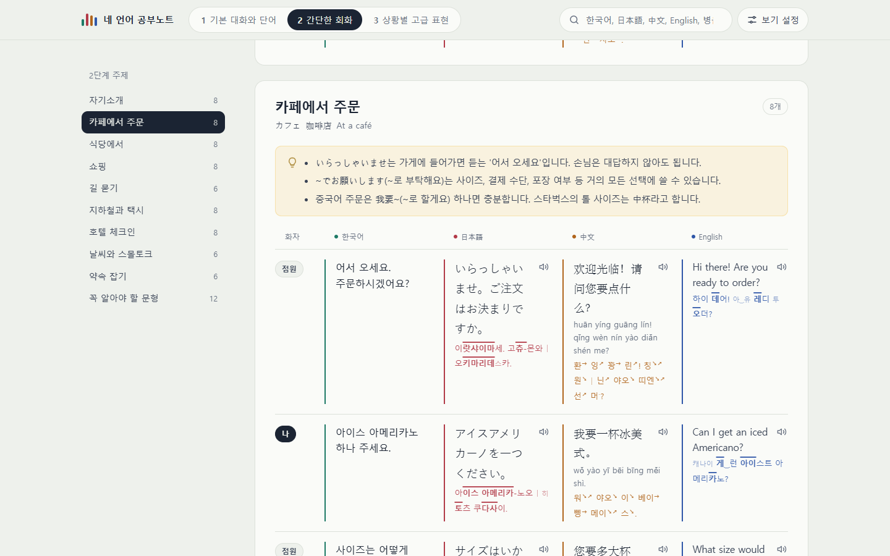
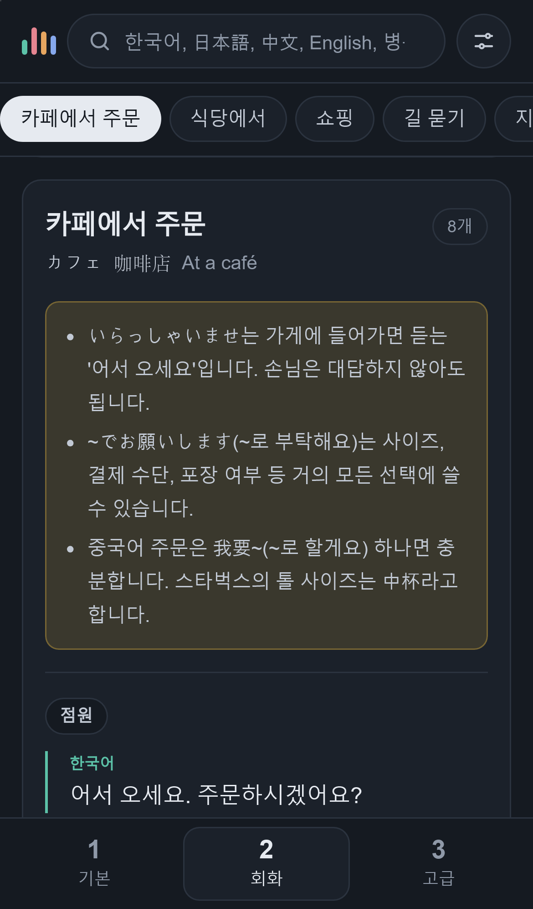

<div align="center">

# 🗣️ 네 언어 공부노트

**한 문장을 한국어 · 日本語 · 中文 · English로 나란히 익히는 오프라인 공부노트**

외국어를 처음 배우는 사람도 읽을 수 있게, 모든 외국어 문장에 **한글 발음**과 **높낮이·속도 표기**를 붙였습니다.




</div>

---

## 목차
- [소개](#-소개)
- [주요 기능](#-주요-기능)
- [미리보기](#-미리보기)
- [빠른 시작](#-빠른-시작)
- [한글 발음 표기 읽는 법](#-한글-발음-표기-읽는-법)
- [프로젝트 구조](#-프로젝트-구조)
- [콘텐츠 추가하기](#-콘텐츠-추가하기)
- [테스트](#-테스트)
- [버전 히스토리](#-버전-히스토리)
- [로드맵](#-로드맵)
- [관리 방식](#-관리-방식)

## 📖 소개
**한국어만 아는 사람**이 일본어, 중국어, 영어를 처음 시작할 때 쓰는 공부노트입니다.

- **한국어로 뜻을 잡습니다.** 같은 문장을 세 외국어로 바로 옆에서 비교합니다.
- **3단계로 나눴습니다.** 인사와 기초 단어 → 상황별 회화(카페, 식당, 길 묻기) → 비즈니스·개발·공항·병원 표현 순서입니다.
- **결과물은 HTML 파일 하나입니다.** 서버도, 설치도, 인터넷도 필요 없습니다. 아이폰 '파일' 앱 미리보기처럼 **JS가 꺼진 환경에서도** 모든 내용이 보입니다.

| 단계 | 내용 | 규모 |
|---|---|---|
| 1. 기본 대화와 단어 | 발음 표기 읽는 법, 문장 구조, 인사, 숫자, 가족, 음식, 시간, 장소, 형용사, 동사, 히라가나·가타카나, 중국어 병음 | 주제 14개 |
| 2. 간단한 회화 | 자기소개, 카페, 식당, 쇼핑, 길 묻기, 지하철·택시, 호텔, 스몰토크, 약속, 핵심 문형 | 주제 10개 |
| 3. 상황별 고급 표현 | 공손함의 단계, 일본어 경어, 미팅, 이메일, 전화, 개발자 협업, 공항, 병원, 클레임, 면접, 은행 | 주제 11개 |

## ✨ 주요 기능
| 기능 | 설명 | JS 없이 |
|---|---|:---:|
| 4개 언어 나란히 보기 | 한국어, 日本語(후리가나), 中文(병음), English | ✅ |
| 한글 발음 + 높낮이·속도 | 일본어 악센트, 중국어 성조, 영어 강세, 연음, 약음, 쉼 | ✅ |
| 공부할 언어 선택 | 日本語, 中文, English를 각각 켜고 끄기 (JS 모드에서는 선택 기억) | ✅ |
| 가리기 | 언어별로 흐리게 가리고, 누르면 그 칸만 보기 (암기 확인용) | ✅ |
| 글자표 | 히라가나·가타카나 전환, 중국어 성조·성모·운모표 | ✅ |
| 🔊 발음 듣기 | Web Speech API (`ja-JP`, `zh-CN`, `en-US`) | ❌ |
| 🔍 검색 | 4개 언어, 병음(성조 기호 없이 `xie xie`), 한글 발음(`오하요`) | ❌ |
| 단계 기억 | 마지막에 본 단계를 다시 열기 | ❌ |
| 라이트·다크 모드 | 시스템 설정을 따름 | ✅ |

## 🖼️ 미리보기
<table>
<tr>
<td align="center"><br><sub>모바일 · 다크 모드</sub></td>
<td align="center"><br><sub>중국어 병음과 성조</sub></td>
</tr>
</table>

## 🚀 빠른 시작
**학습자 (사이트 이용):** 웹사이트에 접속하면 바로 쓸 수 있습니다. 가입이나 설치는 필요 없습니다. 🌐 주소는 공개 후 여기에 적습니다.

> `language-study.html` 파일만 받아서 열어도 오프라인으로 똑같이 동작합니다.

**관리자 (수정과 빌드):**
```bash
npm install            # Playwright만 설치됩니다 (런타임 의존성 없음)
npm run build          # data/ → language-study.html
npm test               # 데이터 검증 → 단위 테스트 → 빌드 → E2E 테스트
```

| 명령 | 하는 일 |
|---|---|
| `npm run validate` | 데이터를 검증합니다 (빈 칸, 기호 짝, 성조 숫자와 병음 음절 수) |
| `npm run test:unit` | `node --test`로 발음 표기 변환과 데이터 구조를 테스트합니다 |
| `npm run build` | 정적 HTML을 빌드합니다 |
| `npm run test:e2e` | Playwright로 아이폰(JS 없음/있음)과 데스크톱 Chrome에서 테스트합니다 |

> Node.js 22 이상을 권장합니다. 데스크톱 E2E는 PC에 설치된 Chrome(`channel: "chrome"`)을 씁니다.

## 🔤 한글 발음 표기 읽는 법
data에는 가벼운 기호로 적고, 빌드할 때 화면용 모양으로 바뀝니다. 자세한 규칙은 [`docs/pron-notation.md`](docs/pron-notation.md)에 있습니다.

| 화면 | data 표기 | 뜻 | 예 |
|---|---|---|---|
| <ins>**굵은 윗줄**</ins> | `[ ]` | 높게 / 세게 | `오[하요-]`, `굿 [모]닝` |
| `→ ↗ ↘↗ ↘ ·` | `1 2 3 4 0` | 중국어 성조 (1~4성, 경성) | `니2 하오3` → 니↗ 하오↘↗ |
| `-` | `-` | 길게 | `토-` |
| `‿` | `_` | 이어서 빠르게 | `[땡]_큐` → 땡‿큐 |
| 작고 흐리게 | `( )` | 약하고 빠르게 | `데(스)` |
| `│` | `\|` | 잠깐 쉼 | 긴 문장의 끊어 읽기 |

## 🗂️ 프로젝트 구조
```text
language-study/
├── language-study.html      # 빌드 결과 (이 파일 하나로 배포)
├── build.mjs                # data → 정적 HTML (CSS와 JS를 inline으로 포함)
├── styles.css               # 디자인 토큰, 반응형, :has() 기반 토글
├── runtime.js               # JS가 있을 때만: 단계 전환, 검색, 발음 듣기, 설정 기억
├── lib/
│   └── pron.mjs             # 한글 발음 표기 변환 (build와 단위 테스트가 함께 사용)
├── data/
│   ├── index.js             # STAGES export + 데이터 형식 설명
│   ├── stage1.js ~ stage3.js
│   ├── kana.js              # 히라가나표
│   └── pinyin.js            # 성조, 성모, 운모표
├── scripts/
│   └── validate-data.mjs    # 데이터 검증
├── tests/
│   ├── unit/                # node:test (발음 변환, 데이터 구조)
│   ├── js.spec.js           # JS 켠 환경 E2E
│   ├── nojs.spec.js         # JS 끈 환경 E2E (아이폰 파일 미리보기)
│   └── structure.spec.js    # 구조, 접근성, 공통 동작
└── docs/
    ├── ROADMAP.md           # 버전별 계획
    ├── pron-notation.md     # 발음 표기 규칙
    └── images/              # README 스크린샷
```

**설계 원칙**
- **Progressive enhancement**: 모든 콘텐츠는 빌드할 때 HTML로 미리 렌더링합니다. 가리기, 언어 선택, 가나 전환처럼 JS 없이도 되는 기능은 `checkbox`와 `:has()`로 만들고, JS는 검색과 발음 듣기처럼 꼭 필요한 곳에만 씁니다.
- **런타임 의존성 0**: 프레임워크와 번들러 없이 Node 내장 모듈만으로 빌드합니다.

## ✍️ 콘텐츠 추가하기
항목 형식은 [`data/index.js`](data/index.js) 맨 위 주석에 있습니다. list 항목은 이런 모양입니다.

```js
// [한국어, [일본어, 가나 읽기, 한글 발음], [중국어, 병음, 한글 발음], [영어, 한글 발음]]
["감사합니다",
  ["ありがとうございます", "", "아[리]가토- 고[자이마](스)"],
  ["谢谢", "xiè xie", "시에4 시에0"],
  ["Thank you.", "[땡]_큐."]]
```

1. 해당 단계 파일(`data/stageN.js`)에 항목을 추가합니다.
2. `npm run validate`로 빈 칸과 성조 숫자 개수를 확인합니다.
3. `npm test`로 전체를 확인합니다.

- 중국어는 **간체**로 쓰고, 병음은 **음절마다 띄어** 씁니다.
- 예문에 실제 개인 이름을 쓰지 않습니다. 이름이 필요하면 `홍길동(ホン・ギルドン / 洪吉童 / Gildong Hong)`처럼 가상 이름을 씁니다.

## 🧪 테스트
| 종류 | 도구 | 범위 |
|---|---|---|
| 데이터 검증 | `scripts/validate-data.mjs` | 모든 항목의 필수 칸, `[ ]`·`( )` 짝, 병음 음절 수와 성조 숫자 개수 일치 |
| 단위 테스트 (14개) | `node:test` | 발음 표기 → HTML 변환, XSS escape, 검색 키, 섹션 id 유일성, 간체 확인, 가상 이름 사용 |
| E2E (3개 환경, 80회) | Playwright | 단계 전환과 기억, 검색, 가리기, 언어 선택, 발음 듣기, 병음표, 가로 스크롤 없음, 링크와 id 무결성, 접근성(aria-label, lang) |

E2E는 모두 **offline + `file://`** 로 실행해서 "데이터 없는 휴대폰" 조건을 재현합니다.

| 프로젝트 | 조건 |
|---|---|
| `iphone13-nojs` | WebKit, JS 꺼짐 (아이폰 파일 앱 미리보기) |
| `iphone13-js` | WebKit, JS 켜짐 (아이폰 Safari) |
| `desktop-chromium` | 데스크톱 Chrome 1440×900 |

## 🏷️ 버전 히스토리
자세한 변경 내역은 [`CHANGELOG.md`](CHANGELOG.md)에 있습니다.

| 버전 | 날짜 | 요약 |
|---|---|---|
| **v1.1.1** | 2026-11-26 | README 추가, 테스트 확대 (단위 테스트 도입, 구조·접근성 E2E), 발음 변환 모듈 분리, 병음 ü 검색 개선 |
| **v1.1** | 2026-11-26 | 🇨🇳 중국어 추가, 모든 외국어에 한글 발음과 높낮이·속도 표기, 공부할 언어 선택, 병음표, 버전 문서 체계 |
| **v1.0** | 2026-11-26 | 한·일·영 3개 언어, 3단계 구성, 가나표, 검색, 가리기, 발음 듣기, JS 없이 보기 |

## 🗺️ 로드맵
자세한 범위는 [`docs/ROADMAP.md`](docs/ROADMAP.md)에 있습니다.

- [x] **v1.0**: 한·일·영 3개 언어 공부노트
- [x] **v1.1**: 중국어, 한글 발음과 높낮이·속도 표기
- [ ] **v1.2**: 기본 / 중급 / 심화로 재편하고, 단계마다 개념(문법) 섹션을 둡니다
- [ ] **v1.3**: ✈️ 여행 대비 (회화, 메뉴판, 표지판)
- [ ] **v1.4**: 📝 문제와 풀이
- [ ] **v1.5**: 🇺🇸 영어 TOEIC

## 🛠️ 관리 방식
- **1인이 관리하는 개인 프로젝트**입니다. 사이트는 누구나 자유롭게 쓸 수 있지만, 코드 기여(PR)는 받지 않습니다.
- 버전 단위로 작업합니다.
  - 대상 버전을 먼저 정합니다 (`docs/ROADMAP.md`).
  - 브랜치는 `feature/vX.Y` 또는 `fix/vX.Y.Z`로 만들고, `main`에 merge한 뒤 `vX.Y` 태그를 답니다.
  - 끝나면 `CHANGELOG.md`, `package.json`의 `version`, ROADMAP, 이 README의 버전 히스토리를 함께 갱신합니다.
- 자세한 작업 규칙은 [`CLAUDE.md`](CLAUDE.md)에 있습니다.
- © 2026 All rights reserved. 코드와 콘텐츠의 재배포는 허용하지 않습니다.

<div align="center"><sub>Made for learners who start from Korean.</sub></div>
